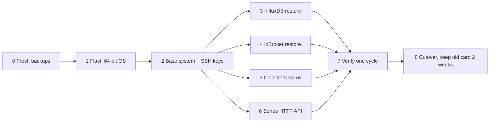

# Rebuild runbook (draft, task 1.3)

Drafted 2026-11-08 from a read-only inventory of the running Pi. The old card stays untouched
until the new one has run green for 24 h (tasks 3.1/3.2). Restore data and configuration, never
binaries: the old system is 32-bit (armv7l) bullseye, the new one 64-bit. See `design.md`.

## 0. Before switching off (old card)

- [ ] `deps/general/bin/influx_backup.sh` and a manual backitup run (ioBroker admin, or
      `iob backup`); wait for the NAS pull marker (`~/.last_nas_backup_success`) to update.
- [ ] Copy `/boot/config.txt` and `/boot/cmdline.txt` somewhere safe: the NAS pull excludes `/boot`.
- [ ] Note the Fritz!Box reservation for the Pi (192.168.178.47) — same board, same MAC, so it
      carries over; the hostname stays `raspberrypi`.

## 1. Flash (new card, on the laptop)

- [ ] Raspberry Pi Imager → Raspberry Pi OS Lite (64-bit). Settings: hostname `raspberrypi`,
      user `pi`, SSH with public-key only (both keys from `~/.ssh/authorized_keys`),
      timezone **Europe/London** (the cron and backup times assume it; moving to Berlin is a
      separate change), locale as before.

## 2. Base system

- [ ] `sudo apt update && sudo apt full-upgrade`; install `git rsync msmtp msmtp-mta mailutils
      cifs-utils build-essential python3-dev libavahi-compat-libdnssd-dev libudev-dev` (the
      last ones for ioBroker's native modules).
- [ ] Restore `/etc/ssh/ssh_host_*` from the NAS snapshot and restart sshd: a new host key
      breaks the NAS's rsync pull (`known_hosts` on the NAS).
- [ ] Restore `~/.ssh/` (keys, `authorized_keys` incl. the NAS key), `~/.msmtprc`,
      `~/.gitconfig`, `~/passwd-nas`, `~/credentials.env` with mode 600.
- [ ] Docker: `curl -fsSL https://get.docker.com | sh`, `sudo usermod -aG docker pi`.
- [ ] Node 22 via NodeSource (works on arm64): `curl -fsSL https://deb.nodesource.com/setup_22.x | sudo bash - && sudo apt install nodejs`.

## 3. InfluxDB

- [ ] `docker run -d --name influxdb --restart unless-stopped -p 127.0.0.1:8086:8086
      -v influxdb-storage:/var/lib/influxdb influxdb:1.8` (this command was never recorded;
      it matches the running container's settings).
- [ ] Copy `~/influx_backup` from the NAS snapshot, then restore it portably:
      `docker cp ~/influx_backup influxdb:/tmp/b && docker exec influxdb influxd restore -portable /tmp/b`.
- [ ] Check: databases `home_monitoring` and `iobroker` exist, retention policies are `INF`,
      `SELECT count(*) FROM electricity_energy_watthour` matches the old card.

## 4. ioBroker

- [ ] Official installer: `curl -sLf https://iobroker.net/install.sh | bash -`.
- [ ] Copy the newest backitup archive from `/opt/iobroker/backups` (NAS snapshot) and
      `iob restore <archive>`; it reinstalls the adapters at their versions (js-controller
      7.2.5) and rebuilds native modules for arm64.
- [ ] Check: all 21 instances green; `iob update` lists nothing unexpected; the vis-2 project
      and the custom nav icons in `files/vis-icontwo/Custom/` are back (README: restore them with
      `iob file write` if not).
- [ ] Deploy the dashboard scripts from the laptop with `make deploy-script DRY_RUN=1` for each
      script: every one must report "already matches the repo".

## 5. Collectors

- [ ] `curl -LsSf https://astral.sh/uv/install.sh | sh`; clone the repo at **current main**
      (the old card's checkout was far behind); `uv sync --python 3.12`.
- [ ] Restore `.env` (mode 600), `cache/`, and `~/.local/state/home_monitoring/healthcheck.json`.
- [ ] `run_home_monitoring.sh` and `deps/general/systemd/home-monitoring-gardena.service`
      point at `<repo>/.venv/bin/python` (change in the repo first, see `design.md`); install
      the unit, `systemctl enable --now home-monitoring-gardena`.
- [ ] Restore the crontab from the NAS snapshot (`/var/spool/cron/crontabs/pi`) via `crontab`.

## 6. Sonos HTTP API

- [ ] Copy `~/node-sonos-http-api` (incl. `settings.js`, `presets/`), `npm ci` inside it,
      install `sonos-http-api.service`, enable it; the Musik band polls it on 127.0.0.1:5005.

## 7. Verify (before cutover)

- [ ] One cycle of every collector writes data (`~/logs/*.log`, fresh points in InfluxDB).
- [ ] Healthcheck run sends nothing (or only expected messages); Diagnose tab green apart
      from known dead sensors.
- [ ] The wall dashboard renders all tabs; Telegram test message arrives.
- [ ] The NAS pull runs the next night against the new card.
- [ ] `unattended-upgrades` installed and configured with a reboot notification (task 2.5).

## 8. Cutover

- [ ] Swap cards; watch 24 h. Rollback = put the old card back (data written meanwhile is lost
      unless the backups are taken again).
- [ ] Keep the old card two weeks, then wipe it; finalise this runbook (task 3.3).
